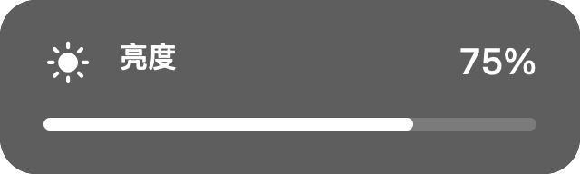

# 更新记录

版本号和构建号以应用 `Info.plist` 为准。以下日期使用北京时间；自动测试、程序内验收与真实硬件验收分别记录。

## 0.8.2 · 构建 13 — 2026-10-28

### 屏幕同步显示音量与亮度

此前双指调节音量、三指调节亮度时，百分比只出现在 Touch Bar 上。本次在电脑屏幕下方增加同步提示，调节时可以直接看屏幕确认结果。

- 提示包含音量／亮度图标、当前百分比和进度条；Touch Bar 保留原有百分比反馈。
- 默认显示在鼠标所在屏幕的可用区域下方居中位置；找不到对应屏幕时回退到主屏幕。
- 提示使用原生 AppKit 非激活面板，不获取键盘焦点、不拦截鼠标；配置为跨桌面显示并支持作为全屏应用的辅助窗口。
- 手势结束后，屏幕提示保留约 0.8 秒再隐藏。连续调节会取消上一次的隐藏任务，避免新的提示被提前关闭。
- 手动收起 Touch Bar、锁屏、息屏、休眠、切换用户或退出应用时，沿用手势取消路径，立即隐藏屏幕提示。
- 音频设备不支持软件调节、设备切换或系统接口失败时，同步显示对应说明，不绘制虚假的进度。
- 双指音量、三指亮度的方向、识别阈值、亮度最低 5% 和多指防误触规则沿用构建 12。

以上为程序生成的模拟数值预览，不是对真实音量、亮度调节结果的截图。

### 实现与资源

- 新增 `ControlHUD`，复用一个提示窗口，按手势事件更新；仅在手势结束时安排一次延迟隐藏，不新增常驻轮询或动画。
- `SystemControls` 返回统一的控制类型、提示文字与可用数值，供屏幕与 Touch Bar 同步展示；错误状态不携带进度值。
- 新增 `--verify-control-hud <目录>`，检查同步反馈、连续调节替换、自动隐藏、即时取消和前台应用／焦点保持，并输出模拟预览。
- 新增屏幕提示的人工验收步骤；源码导出白名单包含本更新记录。
- 本次不新增网络请求、录音或账户权限，不修改任务发送、额度读取及 Token 统计逻辑。

### 验证结果

在 Intel x86_64、macOS 26.7.1、Swift 6.3.2 环境完成：

- `swift test`：66 项测试通过，0 失败。
- `./scripts/build-app.sh`：Release 构建通过，应用使用本地 ad-hoc 签名并通过严格校验。
- `--verify-control-input`：单指点击与多指操作抑制检查通过。
- `--verify-control-hud`：程序内同步显示、旧隐藏任务取消、松手后隐藏、立即取消及焦点保持检查通过；已查看音量、亮度与不可调节三种预览。
- `python3 scripts/smoke-ipc.py .build/release/CodexTouchBar`：stream、gap、disconnect、idle、incompatible 五组模拟协议场景通过。
- 已安装到 `~/Applications/CodexTouchBar.app`，安装版本为 0.8.2、构建号 13；安装后的应用签名与 HUD 检查通过，应用可正常启动。

上述 HUD 检查通过程序注入模拟反馈完成，不改变系统音量或亮度。真实双指／三指滑动、外接音频设备、多显示器与全屏场景，以及真实锁屏／睡眠恢复，仍需按 [实机验收](docs/ACCEPTANCE.md) 操作确认。真实语音提交也未在本次更新中验收。macOS 13 为声明的最低版本，本次未覆盖所有系统版本。

### 升级

此次沿用版本号 0.8.2，将构建号从 12 增至 13，以区别仅有 Touch Bar 反馈的旧安装。退出旧应用后，更新源码并运行 `./scripts/install.sh`；详见 [安装说明](docs/INSTALL.md)。应用目录、可执行文件名及 bundle id 保持兼容。

## 0.8.2 · 构建 12 — 2026-10-14

对应提交：[`1a57620`](https://github.com/likewangxl/CodexToolBar/commit/1a57620eef82be0be5cbe4a9d7558a20d18002b2)。

- 新增 Touch Bar 双指左右滑动调节当前输出设备音量、三指左右滑动调节内置屏幕亮度。手指数稳定约 0.15 秒且位移超过阈值后开始调节，约 400 pt 对应完整范围，亮度最低为 5%。
- 多指操作抑制任务／语音按钮动作；控制锁定后改变手指数会停止调节，全部松手后才能重新开始。锁屏、休眠与手动收起取消手势。
- 亮度私有接口通过运行时检测加载；不支持的音频设备或显示器明确显示不可调节。新增手势状态测试与系统控制探针。
- 兼容新版 ChatGPT 应用中的 `codex-cli/bin/codex` 与 `codex-cli/CodexCLI.app/Contents/MacOS/codex` 路径，恢复因 CLI 移位而失败的额度／Token 查询。
- 将选定图形生成为多尺寸应用图标，保留菜单栏与 Touch Bar 的既有图形。
- 安装脚本先在临时目录复制并验证新包，再替换目标应用；安装成功后清理 dist 应用副本，减少重复应用。

2026-10-28 曾在上述 Intel 本机环境重新构建、安装并检查：66 项测试与五组协议模拟通过；真实账户接口成功返回额度与 Token，系统音量／亮度读取及实时任务连接正常。这些是后续本机复核结果，不代表发布当日完成所有硬件验收。

## 0.8.1 — 2026-09-09

首个公开源码提交：[`f8e5fce`](https://github.com/likewangxl/CodexToolBar/commit/f8e5fced922864a976d508e0cafd4bbfd71965b8)。

- 原生 Swift + AppKit Touch Bar 双任务总览、步骤正文分页、ctx、账户额度及昨日／累积 Token 展示。
- 显式语音输入、文字复核与编辑，再由用户主动发送；发送前校验任务所有者与协议，结果不明时不自动重试。
- 菜单栏未读完成任务角标与任务入口，读取 Codex 本地浅深色、字体和配色设置。
- 跨应用常驻、手动收起策略与系统暂停／恢复处理；协议不兼容时显示状态并禁止相关发送。

2026-09-14 的 [`16f4f17`](https://github.com/likewangxl/CodexToolBar/commit/16f4f17ad450bb696bfd6694317e9d32cb09159f) 补充公开源码与导出包中的选定彩色图形资源。
