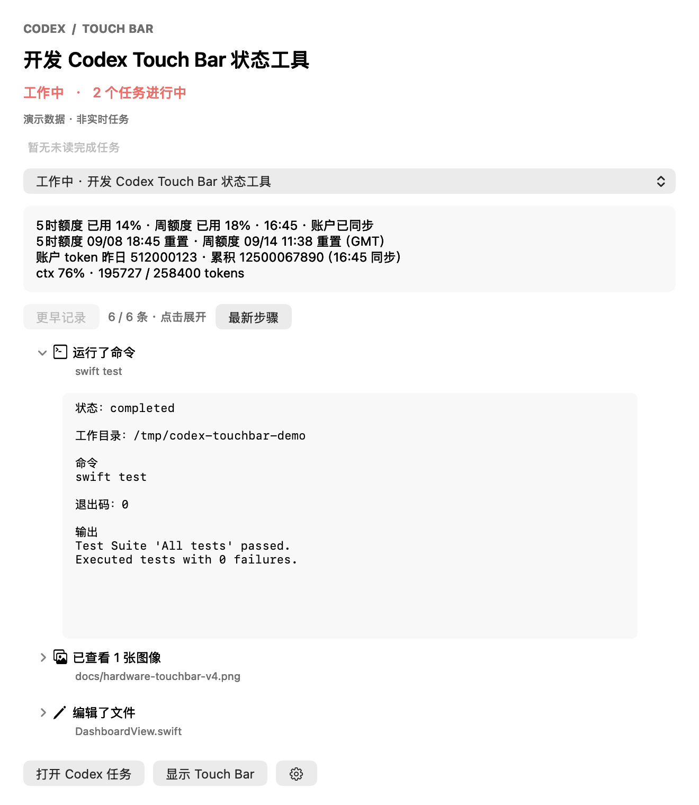

# CodexToolBar

A lightweight, independent macOS Touch Bar companion for the Codex desktop app.

Swift + AppKit 原生工具，版本 **0.8.2**。在 Touch Bar 上查看最近两个任务、执行步骤、ctx、账户额度，并用语音补充指令。面向配有 Touch Bar 的 Mac；界面目前以中文为主。

公开名称为 **CodexToolBar**。为兼容已有安装，Swift target、可执行文件和应用目录暂沿用 `CodexTouchBar`，bundle id 保持 `local.codex.touchbar`。

> 当前为早期实验版本。核心测试和协议夹具已通过；真实语音提交、锁屏及系统睡眠恢复仍待完整实机验收。依赖非公开接口，兼容性可能随 macOS / Codex 更新变化。

## 界面预览

以下是使用模拟任务和模拟额度生成的界面，不包含真实账户或任务信息。当前版本使用用户选定的彩色玻璃圆盘图标；以下历史截图可能仍显示旧图标。


<details>
<summary>菜单栏执行详情（浅色）</summary>



</details>

## 功能

- 菜单栏显示未读完成任务角标；打开对应任务后清除。下拉面板读取 Codex 的浅深色、背景、文字及字体偏好。
- 首页占满可用宽度：5 小时／周额度、剩余比例、系统时区重置时间、昨日／累积 Token，两个任务卡片与大号语音按钮。
- 点击任务直接在 Touch Bar 内查看带图标的步骤，再点步骤查看正文，两行分页；返回、前后翻页、最新步骤保持阅读位置。电脑屏幕详情仅在主动点击时打开。
- 状态及 ctx 通过 Codex 桌面事件更新。断线显示本地记录，未知协议显示“不兼容”，不把旧状态当成实时状态。
- 默认跨应用常驻；手动收起后不会抢回。锁屏、息屏、系统睡眠、切换用户时暂停并关麦；恢复后保留任务页面。
- 首页与详情均可语音输入。接收任务在点击麦克风时固定；停止录音后复核文字，点击“编辑”打开轻量纠错窗口，保存回 Touch Bar，最终点击“发送”才提交。
- 语音发送前重新核对任务所有者和协议，保持任务原模型及权限。发送结果不明时不自动重试，并提供复制入口。

## 安装与使用

需要 macOS 13+、Swift 5.9+ / Xcode 命令行工具，以及已登录的 Codex 桌面应用。

```sh
git clone https://github.com/likewangxl/CodexToolBar.git
cd CodexToolBar
swift test
./scripts/install.sh
```

安装到 `~/Applications/CodexTouchBar.app`。升级前从工具菜单退出；脚本验证新包后替换旧版，不保留旧应用，并清除安装用的 dist 应用副本。源码构建为当前 CPU 架构，目标 Touch Bar Intel Mac 应在 Intel 环境构建。

右键菜单栏可刷新额度与 Token、查看连接诊断、开启登录启动和跨应用常驻。首次点麦克风时按系统提示允许麦克风与语音识别。完整安装、权限和卸载说明见 [安装说明](docs/INSTALL.md)。

## Touch Bar 手势

Touch Bar 手势：工具显示区域内，双指左右滑动调节当前输出设备音量，三指左右滑动调节内置屏幕亮度。左滑降低、右滑提高；手指数稳定约 0.15 秒且滑动超过阈值后开始，约 400 pt 对应完整调节范围。亮度最低为 5%。调节时临时显示百分比，松手后恢复原页面。

多指触摸会阻止任务、语音等按钮动作；调节开始后改变手指数会停止本次调节，需全部松手再开始。锁屏、休眠及手动收起会取消手势。系统控制条、其他应用的 Touch Bar 区域及外接显示器不在控制范围内。不支持的软件音量或亮度接口会显示不可调节。亮度使用运行时检测的 DisplayServices 私有接口；真实多指操作和不同音频设备需实机验收。系统“Touch Bar 缩放”可能影响手势识别。

## 数据口径和刷新

- **ctx**：最近一次请求 `last.totalTokens / modelContextWindow`，允许压缩后下降；不使用累积 Token。
- **额度**：官方 `account/rateLimits/read` 的 Codex 桶，按 `windowDurationMins` 匹配窗口，字段不存在时保持未知，不使用其他产品的额度填充。
- **昨日／累积**：官方 `account/usage/read`。累积直接使用 `summary.lifetimeTokens`；昨日按系统日历日期匹配 `dailyUsageBuckets`。服务端没有给出日期桶时显示“—”，不猜测为零。Touch Bar 的“亿”保留两位小数。
- **同步**：启动、恢复、显式刷新立即读取；平时约 5 分钟一次，已到重置时间时最多每分钟补查。失败按 1/2/4/5 分钟退避。一次短暂 app-server 连接读取两类统计，20 秒期限、2 MiB 输出上限，结束后退出。
- **失败／过期**：额度保留上次值并标注“同步失败”；超过 10 分钟标注“数据过期”；已到重置时间但尚未更新时标为“待同步”。详情提供实际观测时间。Token 读取失败显示未知，不使用本地日志合计代替。
- 一项账户接口失败不影响另一项成功结果。上游统计是否即时更新由 Codex 服务决定；刷新时间是成功取回时间。无适用账户登录或不支持接口的版本会显示不可用。

## 资源与隐私

任务状态/ctx 采用 IPC 和文件事件，合并约 250 ms 的变化；文件尾读限额 512 KiB。只维护两个首页任务和额外选中的详情任务。历史步骤在进入详情时按需索引，退出释放。没有动画和全文滚动计时器，不启动历史 Token 全量扫描。

录音仅由用户点击启动，最长 55 秒；结束立即关麦，等待识别完成最长 25 秒。优先 Apple 本机识别，设备不支持时明确显示 Apple 联网识别。文字仅在内存中保存，编辑窗口不自动保存磁盘，锁屏/休眠关闭编辑窗口并保留已确认草稿。仅点击“发送”时提交文字给指定 Codex 任务。

工具不直接读取/保存登录凭据，账户查询复用 Codex CLI 登录。默认只在内存保留最近 100 条诊断元数据；显式开始验收记录后才写入本工具缓存，不记录消息或录音正文。诊断可能包含应用 bundle id、目标任务标识尾部、状态、时间和计数，反馈前请检查文件。

## 兼容性与验收

跨应用显示使用运行时检测的私有 AppKit/DFR 接口。任务观察适配桌面流 v11，发送适配 start v2 / steer v1；这些接口可能随系统或 Codex 更新改变。不兼容时可继续看本地记录，相关任务禁止发送。详见 [兼容性](docs/COMPATIBILITY.md)。

CI 验证 Swift、模拟协议、构建及签名，不代表通过真实 Touch Bar、麦克风和睡眠唤醒验收。实机操作与判定标准见 [验收步骤](docs/ACCEPTANCE.md)。

## 开发与贡献

```sh
swift test
./scripts/build-app.sh
python3 scripts/smoke-ipc.py .build/release/CodexTouchBar
# 生成新的源代码审阅目录，不上传、不初始化 Git
python3 scripts/export-source.py /tmp/codex-touchbar-source-review
```

公开目录采用白名单，不包含私人截图、诊断日志或历史备份。菜单栏、Touch Bar 与应用图标使用同一套 Logo；构建脚本生成多尺寸 AppIcon.icns。详见 [贡献说明](CONTRIBUTING.md) 和 [NOTICE](NOTICE.md)。

源码许可：[MIT](LICENSE)。本项目不是 OpenAI 或 Apple 官方产品。

### 0.8.1 菜单栏外观与完成提醒

菜单栏与 Touch Bar 复用同一张彩色图标。右上角数字表示工具运行期间观察到的未读完成任务（超过 9 个显示 9+）；只有实时任务从执行中进入完成才通知。初次载入的历史完成、失败、断线不产生新角标。打开对应的 Touch Bar 任务或屏幕详情会清除该任务提醒；下拉面板也提供“已完成任务”入口和任务列表圆点。提醒保存在内存中，退出后清除，跟随当前监控任务范围。

屏幕详情面板读取 Codex 本地 `config.toml` 中 `desktop.appearanceTheme` 及对应 Light/DarkChromeTheme 的背景、文字、强调色和字体设置。支持浅色、深色和跟随系统；原生控件保留 macOS 的形状与交互。字体未在系统中安装时回退系统字体，不下载安装字体。这里只读取外观配置，不修改 Codex 设置。

图标仅在角标数量变化时重绘。外观使用文件事件合并通知，文件未变不重复读取；面板关闭时不更新详情，重新打开时同步设置。不新增定时轮询、动画或网络请求。
